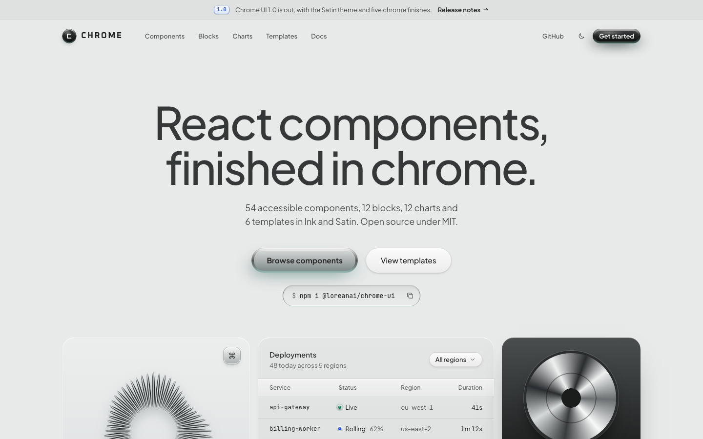

# Chrome UI



Chrome UI is an open-source React component library finished in **satin chrome**: every chrome part is built like the real thing — a pill frame with a gradient stroke, a bezel ring, a satin inner pill and a tinted glow underneath — on quiet satin and ink surfaces. Chrome marks edges, selection, knobs and the one action that matters; everything else stays calm.

It is fully original and does not use Shadcn, Tailwind or glass blur. Radix primitives provide accessible behaviour for complex controls; every visual layer is custom CSS.

## What is included

- `@loreanai/chrome-ui`, an ESM React and TypeScript package with generated declarations
- 54 base components across inputs, navigation, feedback, overlays and data display
- 12 chrome charts in pure SVG (area, line, bar, bar list, gauge, radial rings, heatmap, sparkline, donut, scatter, funnel, waveform)
- Two themes, Satin (light) and Ink (dark), switchable per subtree, with system, full and reduced motion
- A documentation site with foundations, a component catalog and a page per component, 12 blocks assembled from the components, and 6 full templates (dashboard, control room, finance desk, agent console, analytics, settings)
- Unit, accessibility, package-consumer and browser tests

## Quick start

```sh
npm install @loreanai/chrome-ui
```

Import the stylesheet once and wrap your application in `ChromeProvider`:

```tsx
import { Button, ChromeProvider } from "@loreanai/chrome-ui";
import "@loreanai/chrome-ui/styles.css";

export function App() {
  return (
    <ChromeProvider defaultTheme="satin" motion="system">
      <Button finish="graphite">Cancel</Button>
      <Button finish="polished">Deploy</Button>
    </ChromeProvider>
  );
}
```

The styles use Plus Jakarta Sans, Oxanium and JetBrains Mono through `--chrome-font-sans`, `--chrome-font-display` and `--chrome-font-mono`; load them (for example from Fontsource) or override the tokens. See [the package README](packages/chrome-ui/README.md) for the Button API, themes and the full component list.

To run the workspace locally:

```sh
corepack enable
pnpm install
pnpm dev
```

The docs app reads the package source directly, so package edits hot-reload.

## Workspace

```text
apps/docs              Documentation site, blocks and templates
packages/chrome-ui     Installable @loreanai/chrome-ui package
scripts                Package-consumer smoke validation
```

## Development

```sh
pnpm dev          # start the docs app on the package source
pnpm build        # build the package and the documentation
pnpm typecheck    # typecheck every workspace package
pnpm lint         # lint the workspace
pnpm test         # unit and accessibility tests
pnpm test:package # pack and test an isolated package consumer
pnpm test:e2e     # browser tests against the built docs
pnpm validate     # full non-browser validation suite
```

## Design principles

- One polished part per panel. Everyday actions are graphite or ghost; cobalt confirms, focuses and shows progress; enamel destroys or flags failure.
- Wells read recessed, pills read raised, and light always comes from above.
- Chrome at the edges, the selection, the knobs and the primary action; large areas stay quiet satin.
- Real controls with keyboard access, a visible focus ring, 4.5:1 text contrast and reduced-motion support.
- Every theme difference lives in tokens, so an Ink panel can sit on a Satin page.

## Contributing

Contributions are welcome. Read [CONTRIBUTING.md](CONTRIBUTING.md) before opening a pull request. For security issues, follow [SECURITY.md](SECURITY.md).

## License

Chrome UI is available under the [MIT License](LICENSE).
