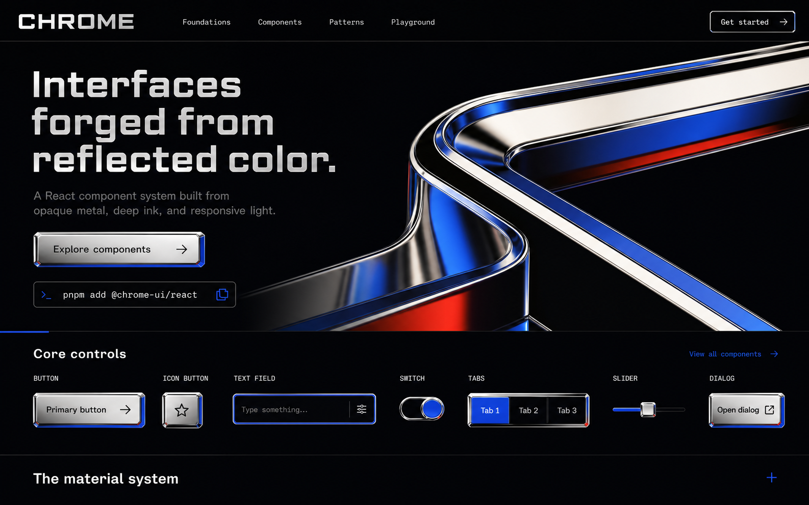

# Chrome UI



Chrome UI is an open-source React component library built around **Reactive Chrome**: an opaque metal interface language shaped by polished silver, deep ink, cobalt focus, enamel-red state, hard seams, and responsive light.

It is fully original and does not use Shadcn, Tailwind, glass blur, or translucent card styling. Radix primitives provide accessible behavior for complex controls while every visual layer and component anatomy is custom.

## What is included

- `@chrome-ui/react`, an ESM React and TypeScript package with generated declarations
- Ink and arctic themes with system, full, and reduced motion modes
- ChromeProvider and `useChrome()` theme APIs
- 17 documented components, including buttons, fields, selection controls, overlays, feedback, and surfaces
- A responsive Vite documentation app with foundations, component explorer, playground, and Control Room pattern
- Self-hosted Space Grotesk, JetBrains Mono, and Oxanium typography
- Unit, accessibility, package-consumer, and browser test coverage

## Quick start

The package is npm-ready but has not been published to the npm registry yet. To run it from this repository:

```sh
corepack enable
pnpm install
pnpm dev
```

Then open the local URL shown by Vite.

When consuming the package, import the library stylesheet once and wrap your application with `ChromeProvider`:

```tsx
import { Button, ChromeProvider } from "@chrome-ui/react";
import "@chrome-ui/react/styles.css";

export function App() {
  return (
    <ChromeProvider defaultTheme="ink" motion="system">
      <Button variant="primary">Create project</Button>
    </ChromeProvider>
  );
}
```

## Component catalog

`Surface`, `Button`, `IconButton`, `TextField`, `Select`, `Checkbox`, `RadioGroup`, `Switch`, `Slider`, `Tabs`, `Badge`, `Tooltip`, `DropdownMenu`, `Dialog`, `Toast`, `Progress`, and `ChromeProvider`.

## Workspace

```text
apps/docs              Documentation and interactive examples
packages/chrome-ui     Installable @chrome-ui/react package
scripts                Package-consumer smoke validation
```

## Development

```sh
pnpm dev          # build the package and start the docs app
pnpm build        # build package and documentation
pnpm typecheck    # typecheck every workspace package
pnpm lint         # lint the workspace
pnpm test         # unit and accessibility tests
pnpm test:package # pack and test an isolated package consumer
pnpm test:e2e     # browser interaction tests
pnpm validate     # full non-browser validation suite
```

## Design principles

- Opaque surfaces only—no backdrop blur or glass transparency
- Silver for primary actions, cobalt for focus and progress, and enamel red for destructive or live state
- Hard seams, clipped corners, narrow highlights, and restrained depth
- Keyboard access, visible focus, reduced-motion support, and 44px mobile targets
- Open rails, dividers, lists, and canvases instead of generic card grids

## Contributing

Contributions are welcome. Read [CONTRIBUTING.md](CONTRIBUTING.md) before opening a pull request. For security issues, follow [SECURITY.md](SECURITY.md).

## License

Chrome UI is available under the [MIT License](LICENSE).
