<div align="center">


# Chrome UI

**React components, finished in chrome.**

54 accessible components, 12 charts, 12 blocks and 6 templates,<br>
in a satin light theme and an ink dark theme. Open source under MIT.

[](https://www.npmjs.com/package/@loreanai/chrome-ui)
[](https://github.com/hitrich/chrome-ui/actions/workflows/ci.yml)
[](https://react.dev)
[](packages/chrome-ui/README.md)
[](LICENSE)

[Quick start](#quick-start) · [The chrome build](#the-chrome-build) · [Components](#components) · [Charts](#charts) · [Templates](#templates) · [Theming](#theming) · [API reference](packages/chrome-ui/README.md)

<br>

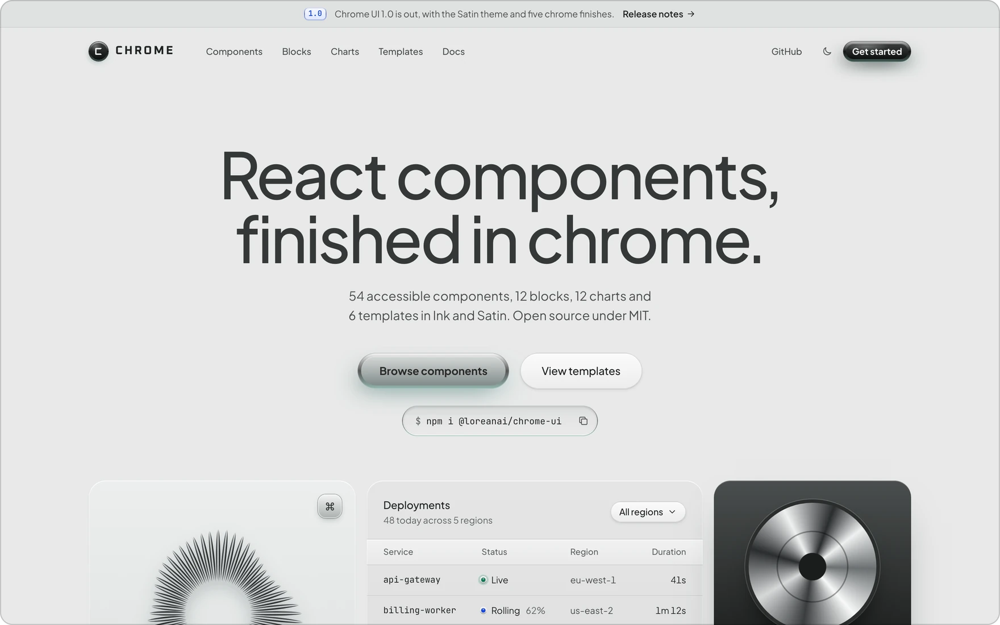

</div>

## The chrome build

Every chrome part is built like the real thing: a pill frame with a gradient stroke, a bezel ring, a satin inner pill and a tinted glow underneath. Chrome marks the edges, the selection, the knobs and the one action that matters. Everything else stays quiet satin.

<picture>
  <source media="(prefers-color-scheme: dark)" srcset=".github/readme/finishes-ink.webp">
  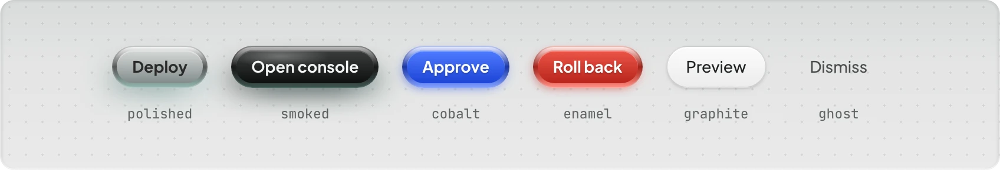
</picture>

| Finish | Use it for |
| --- | --- |
| `polished` | The one primary action on a panel |
| `smoked` | The lead action on Satin pages |
| `cobalt` | Confirming: approve, save, send |
| `enamel` | Destroying or rolling back |
| `graphite` · `ghost` | Everything else |

## Quick start

```sh
npm install @loreanai/chrome-ui
```

Import the stylesheet once and wrap your app in `ChromeProvider`:

```tsx
import { Button, ChromeProvider } from "@loreanai/chrome-ui";
import "@loreanai/chrome-ui/styles.css";

export function App() {
  return (
    <ChromeProvider defaultTheme="satin">
      <Button finish="graphite">Cancel</Button>
      <Button finish="polished">Deploy to production</Button>
    </ChromeProvider>
  );
}
```

The styles use **Plus Jakarta Sans**, **Oxanium** and **JetBrains Mono** through `--chrome-font-sans`, `--chrome-font-display` and `--chrome-font-mono`. Load them yourself (Fontsource works well) or point the tokens at your own fonts. React 18 and 19 are supported.

## Two themes

<table>
  <tr>
    <td width="50%">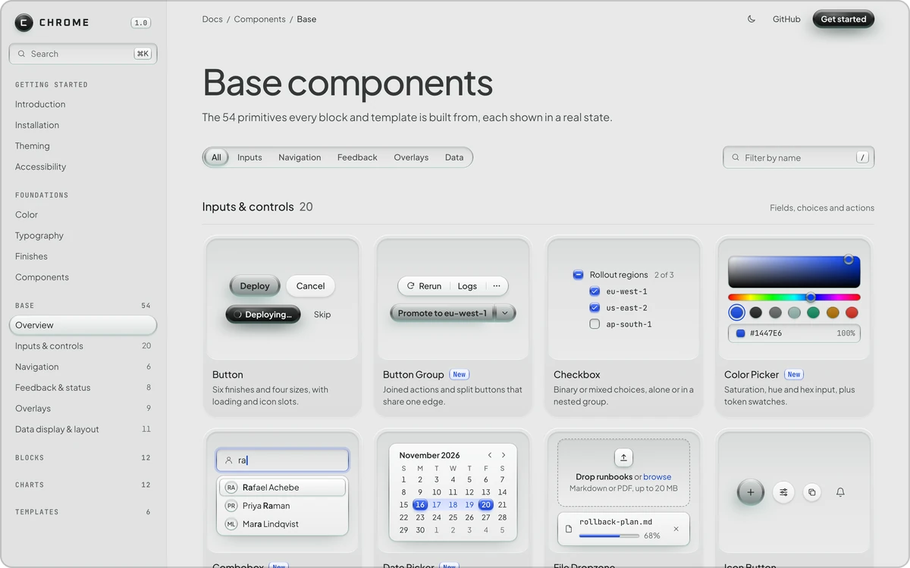</td>
    <td width="50%">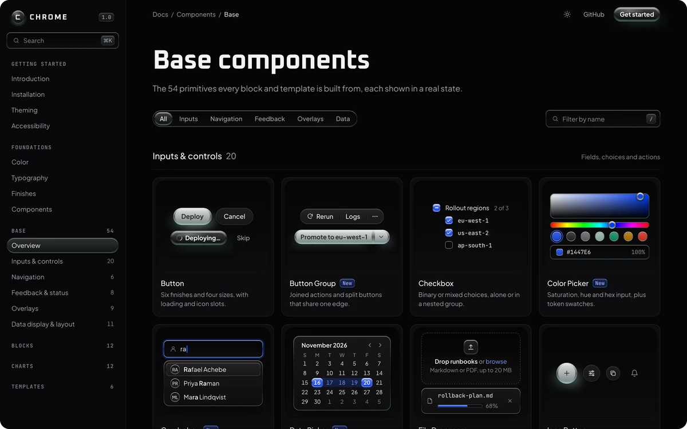</td>
  </tr>
  <tr>
    <td align="center"><b>Satin</b> · brushed light metal</td>
    <td align="center"><b>Ink</b> · smoked dark metal</td>
  </tr>
</table>

Every theme difference lives in tokens, so an Ink panel can sit on a Satin page:

```tsx
<ChromeProvider theme="satin">
  <Dashboard />
  <ChromeProvider theme="ink">
    <AgentLog />
  </ChromeProvider>
</ChromeProvider>
```

## Components

Every component is a real control with keyboard support, focus management and ARIA, built on [Radix](https://www.radix-ui.com) primitives or the WAI-ARIA patterns. Each has unit and axe tests.

| Group | | Components |
| --- | :-: | --- |
| **Inputs & controls** | 20 | `Button` `ButtonGroup` `Checkbox` `ColorPicker` `Combobox` `DatePicker` `FileDropzone` `IconButton` `InputOTP` `NumberField` `RadioGroup` `SearchField` `SegmentedControl` `Select` `Slider` `Switch` `TagInput` `TextField` `Textarea` `ToggleButton` |
| **Navigation** | 6 | `Breadcrumb` `Pagination` `Stepper` `Tabs` `Toolbar` `TreeView` |
| **Feedback & status** | 8 | `Alert` `Badge` `EmptyState` `Meter` `Progress` `Skeleton` `Spinner` `StatusIndicator` |
| **Overlays** | 9 | `CommandPalette` `ContextMenu` `Dialog` `Drawer` `DropdownMenu` `HoverCard` `Popover` `Toast` `Tooltip` |
| **Data display & layout** | 11 | `Accordion` `Avatar` `Calendar` `Chip` `CodeBlock` `Divider` `KeyHint` `Stat` `Surface` `Table` `Timeline` |

`ChromeProvider` and `useChrome()` handle theme and motion. Props for every component are in the [package README](packages/chrome-ui/README.md) and on its page in the docs app.

## Charts

Twelve charts drawn in pure SVG, with no chart library. They use the same chrome as the buttons: polished wires, satin pill bars, bezel gauges and metal beads, with one cobalt series in focus.

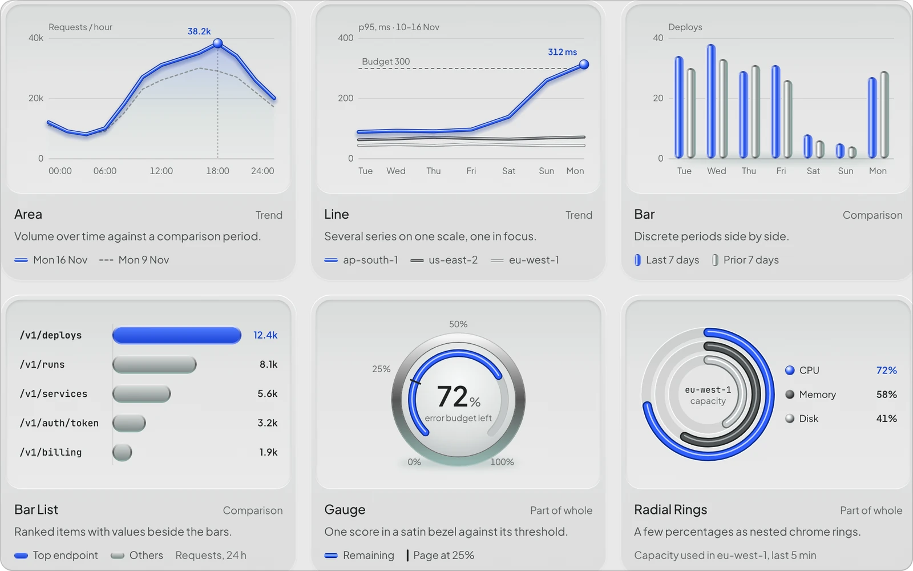

`AreaChart` `LineChart` `BarChart` `BarList` `Gauge` `RadialRings` `Heatmap` `Sparkline` `DonutChart` `ScatterChart` `FunnelChart` `Waveform`

```tsx
<AreaChart
  aria-label="Requests per hour, today against last week"
  labels={hours}
  series={[
    { label: "Today", data: today, finish: "cobalt", area: true },
    { label: "Last week", data: lastWeek, finish: "dashed" }
  ]}
  height={220}
/>
```

Charts size themselves to their container and keep hairlines on whole pixels. Each one needs an `aria-label`; `description` and `dataTable` add a text summary or a visually hidden table.

## Blocks

Twelve ready-made sections assembled from the components: Sidebar, Command Bar, Data Grid, Agent Run, Auth Panel, Settings Panel, Notification Center, Stat Deck, Pricing Table, Upload Queue, Activity Feed and Composer. They live in the docs app as code you can copy.

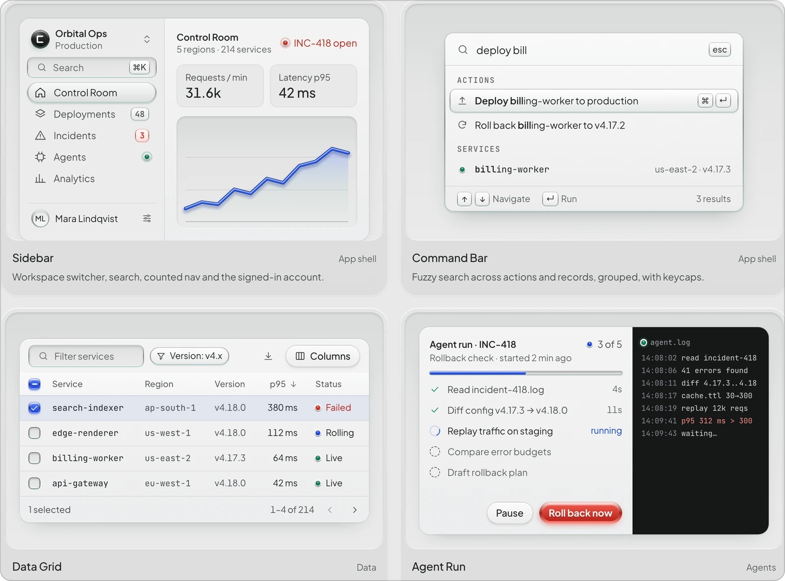

## Templates

Six complete screens set in one fictional world (Orbital Ops, Harbor & Pine and Tidewater Goods). Every control on them works.

<table>
  <tr>
    <td width="50%">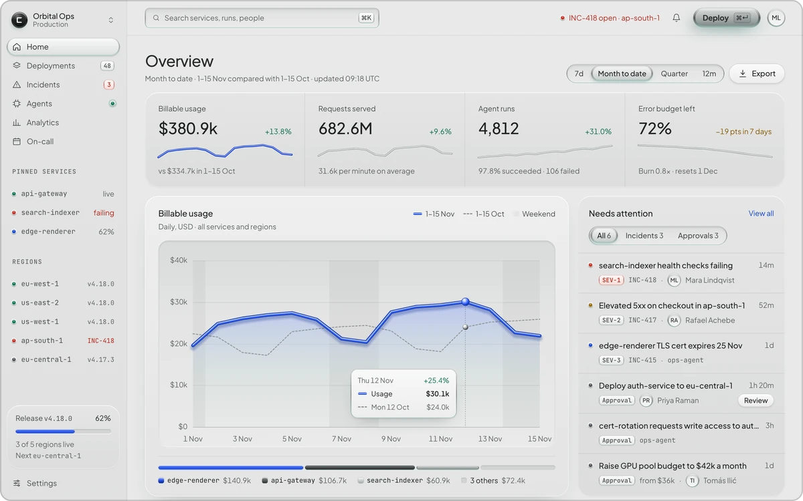<br><b>Dashboard</b> · usage, attention queue and deployments</td>
    <td width="50%">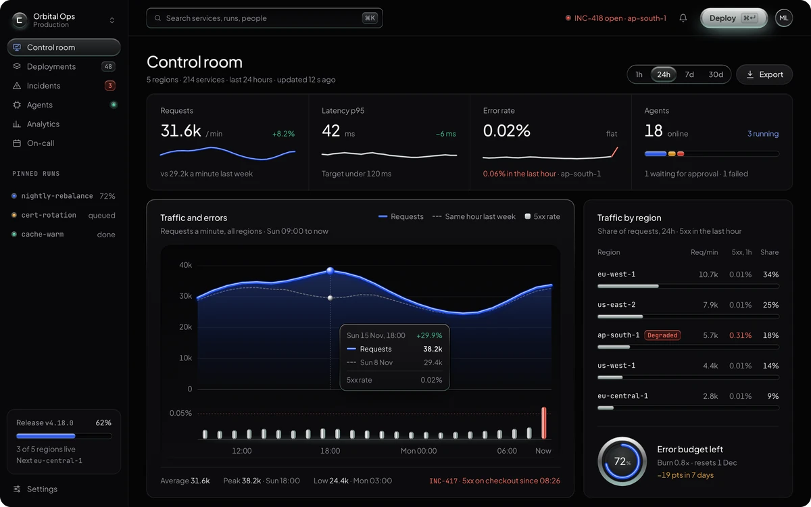<br><b>Control room</b> · live traffic, incidents and an agent run, in Ink</td>
  </tr>
  <tr>
    <td>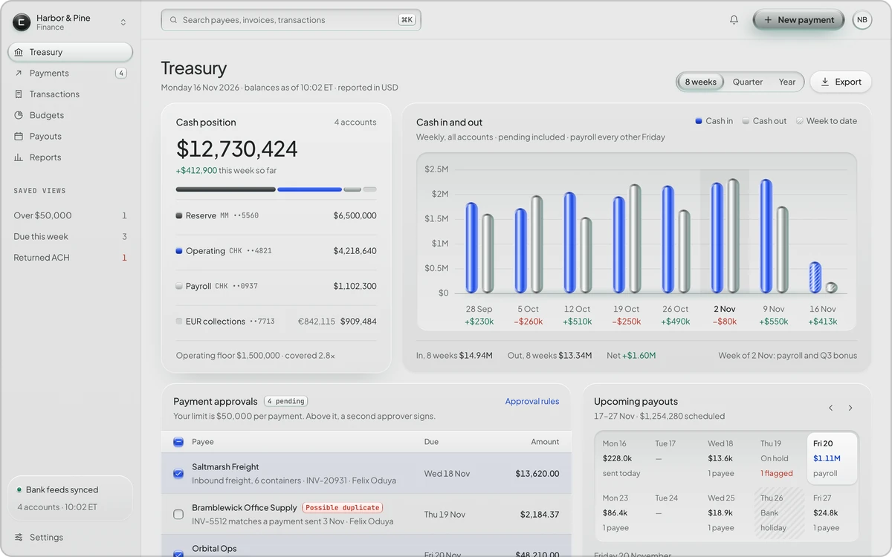<br><b>Finance desk</b> · cash flow, payment approvals and payouts</td>
    <td>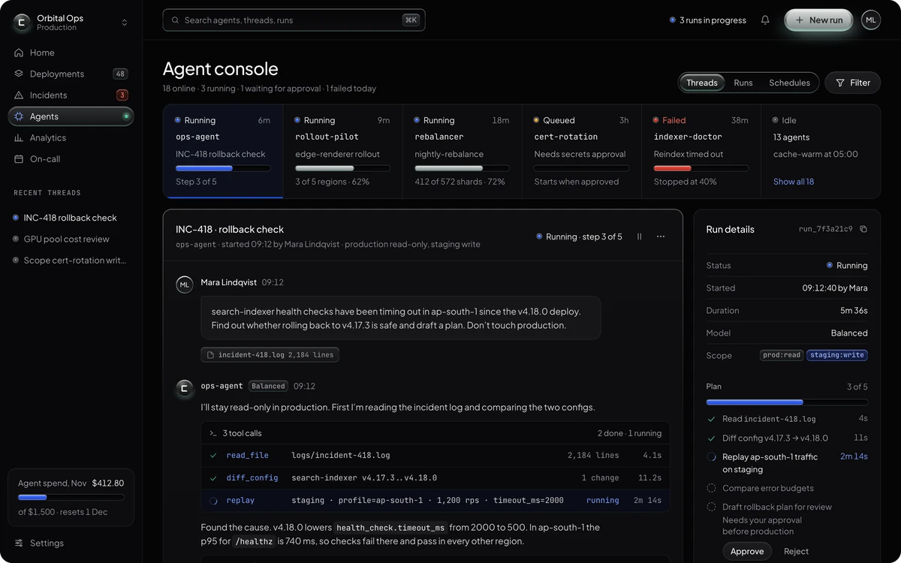<br><b>Agent console</b> · agent fleet, threads and run details, in Ink</td>
  </tr>
  <tr>
    <td>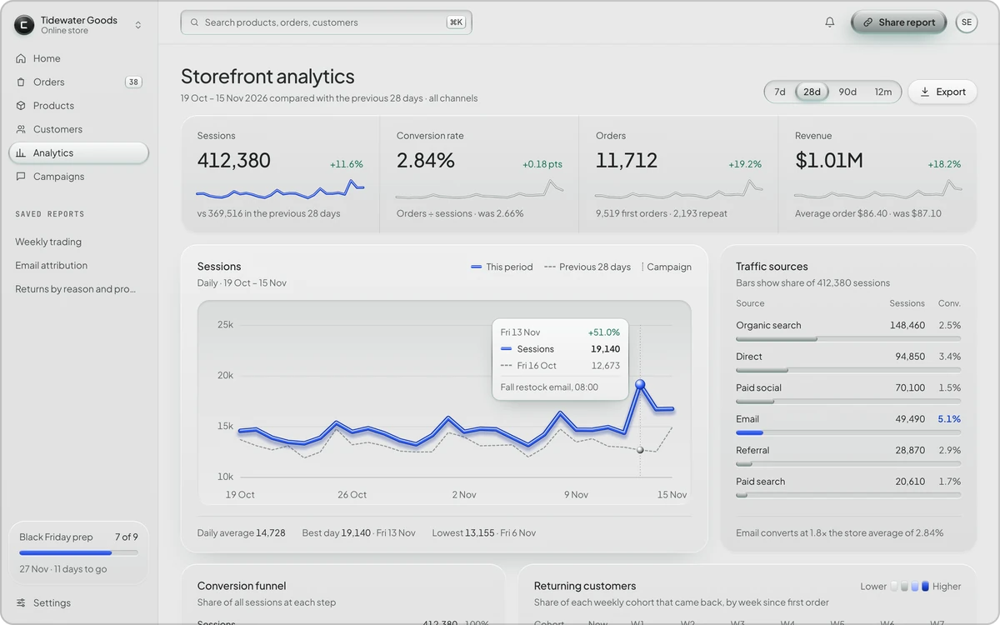<br><b>Analytics</b> · sessions, traffic sources, funnel and cohorts</td>
    <td>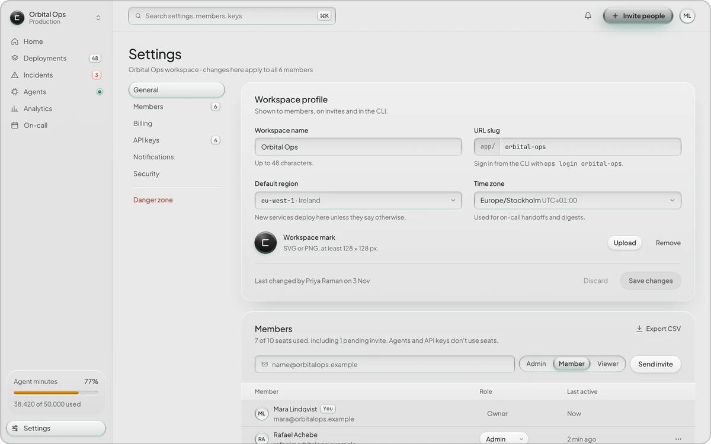<br><b>Settings</b> · profile, members, API keys, security and danger zone</td>
  </tr>
</table>

## Theming

The provider renders `.chrome-root[data-chrome-theme]`, and everything reads tokens from it. Override any token on a root to re-tint a subtree:

```css
.brand-root {
  --chrome-cobalt: #0f62fe;      /* focus, selection, progress */
  --chrome-enamel: #da1e28;      /* destructive and failing */
  --chrome-font-sans: "Inter Variable", sans-serif;
}
```

| Tokens | What they control |
| --- | --- |
| `--chrome-bg` `--chrome-surface` `--chrome-raised` `--chrome-line` | Surfaces and hairlines |
| `--chrome-text` `--chrome-text-2` `--chrome-text-3` | Text, from primary to quiet |
| `--chrome-cobalt` `--chrome-enamel` `--chrome-mint` `--chrome-amber` | Semantic colour |
| `--chrome-rim` `--chrome-well` `--chrome-pill-*` `--chrome-halo` | The chrome build itself |
| `--chrome-font-sans` `--chrome-font-display` `--chrome-font-mono` | Type |

Motion follows `prefers-reduced-motion`, or force it with `<ChromeProvider motion="reduced">`.

## Accessibility

- Real buttons, inputs and links throughout, with one visible focus ring: 2 px of `--chrome-focus` at a 2 px offset.
- Keyboard patterns from Radix and the WAI-ARIA authoring practices: combobox, calendar grid, tree, menus, dialogs and drawers.
- Text holds 4.5:1 contrast in both themes, and selection stays legible.
- Every chart has an accessible name, with an optional text summary or data table.
- Reduced motion is respected, and forced-colors mode swaps the metal for system borders.

## Develop

```sh
corepack enable
pnpm install
pnpm dev
```

The docs app reads the package source directly, so package edits hot-reload.

| Script | |
| --- | --- |
| `pnpm dev` | Docs app on the package source |
| `pnpm build` | Build the package and the docs |
| `pnpm test` | Unit and accessibility tests |
| `pnpm test:e2e` | Browser tests against the built docs (run `pnpm exec playwright install chromium` once) |
| `pnpm test:package` | Pack the package and type-check a clean consumer |
| `pnpm validate` | Lint, typecheck, tests, package check and build |

```text
packages/chrome-ui    the published @loreanai/chrome-ui package
apps/docs             docs site, blocks and templates
scripts               package-consumer smoke test
```

## Principles

- **One polished part per panel.** Graphite and ghost carry everyday actions; cobalt confirms; enamel destroys.
- **Light comes from above.** Wells read recessed, pills read raised.
- **Chrome is earned.** It goes on edges, selection, knobs and the primary action. Large areas stay quiet.
- **No glass, no blur.** Opaque satin and ink surfaces only.
- **Real software.** Every control works with a keyboard, a screen reader and a mouse.

## Contributing

Contributions are welcome. Read [CONTRIBUTING.md](CONTRIBUTING.md) before opening a pull request, and report security issues as described in [SECURITY.md](SECURITY.md).

<br>

<div align="center">
<br>
<sub>Chrome UI is released under the <a href="LICENSE">MIT License</a>.</sub>
</div>
